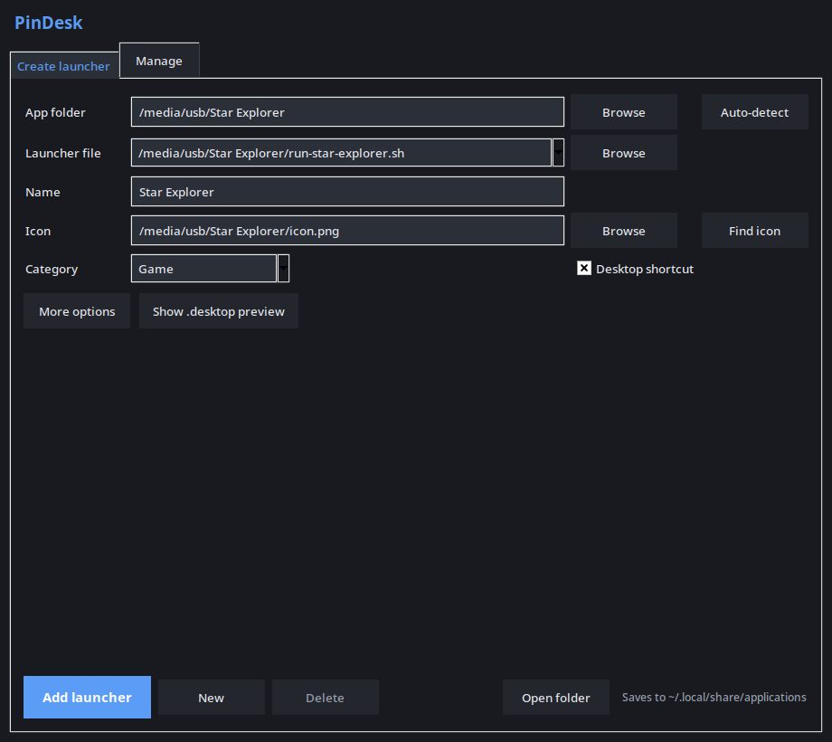
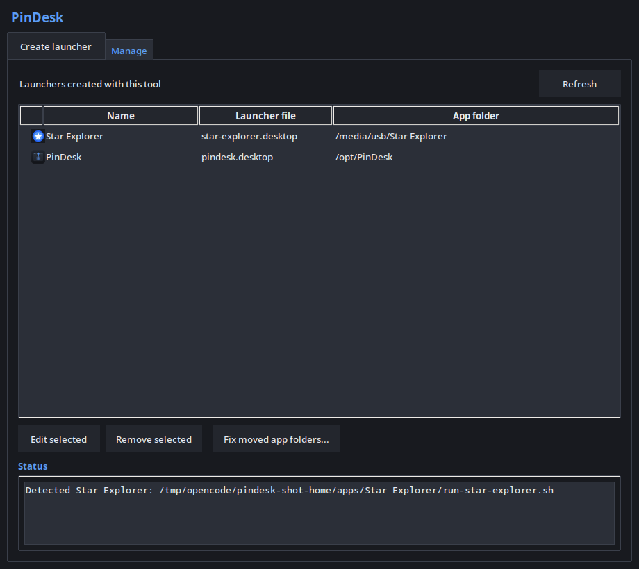

<h1 align="center">
  <br>
  PinDesk
</h1>

<p align="center">
  <b>Turn any portable Linux app into a real desktop launcher — in a few clicks.</b>
</p>

<p align="center">
  
  
  
  
</p>

PinDesk is a small graphical tool for creating and managing `.desktop` launchers
for portable apps, AppImages and launch scripts. You point it at a folder, click
**Auto-detect**, and click **Add launcher**. No terminal, no hand-written
`.desktop` files, no guessing how to escape a path with spaces.

It never runs the app you select. It only reads local files and writes launchers
into your own XDG directories. There is no account, no network access and no
telemetry.

## Screenshots

**Create a launcher**



**Manage existing launchers**



## Why PinDesk?

A portable app often works only when started through its own wrapper script,
from its own folder. A hand-made shortcut usually misses at least one of these:

| Problem | What PinDesk does |
| --- | --- |
| The app needs `LD_LIBRARY_PATH` or Qt environment variables set by its start script | Detects and prefers the wrapper script over the inner ELF binary |
| The app checks for `portable.txt` in the current directory | Writes `Path=` so portable mode actually works |
| Paths contain spaces, `$`, quotes, backslashes or `%` | Escapes `Exec=` according to the freedesktop Desktop Entry spec |
| The USB drive is unplugged | Adds `TryExec=` so the stale entry stays hidden instead of failing |
| Icons are hard to find | Searches only local folders, launch scripts and installed icon themes, then generates an initials SVG |
| The drive gets a new mount point | **Fix moved app folders…** rewrites paths for all affected launchers |

## Features

- **Two tabs:** create and manage launchers.
- **Auto-detection** of executable, name, working directory and icon.
- **Native file dialogs:** uses `kdialog`, `zenity` or `yad` when available, with a Tk fallback.
- **Safe candidate filtering:** shared libraries (`.so`) and uninstaller scripts are never offered as launch targets.
- **Live preview** of the generated `.desktop` file before saving.
- **Validation** with `desktop-file-validate` when that tool is installed.
- **Optional desktop shortcut** with a best-effort trust flag for GNOME.
- **Icon column** in the Manage tab, so launchers are easy to recognise.
- **Single fixed dark theme** with plain, readable widgets — nothing to configure.
- **One Python file.** No build step, no package install, no dependencies required.

## Requirements

- Linux with a graphical session (KDE Plasma, GNOME, XFCE, etc.)
- Python 3.9+ with `tkinter`
  - Fedora / Nobara: `sudo dnf install python3-tkinter`
  - Debian / Ubuntu: `sudo apt install python3-tk`
- Optional but recommended: `desktop-file-validate` from `desktop-file-utils`
- Optional: `kdialog` / `zenity` / `yad` for native dialogs, `gio` for desktop-icon trust

Pillow is optional. When present it improves icon scaling; without it PinDesk
still works using only the Python standard library.

## Get started

```sh
git clone https://github.com/F1tixx/PinDesk.git
cd PinDesk
python3 pindesk.py
```

> Want the smallest download? The latest release also has an **app-only ZIP**
> containing just `pindesk.py`, the install/uninstall scripts, README, license
> and logo — no docs or CI folders.

To add PinDesk itself to your application menu:

```sh
bash install.sh
```

To remove that menu entry later:

```sh
bash uninstall.sh
```

See [docs/USAGE.md](docs/USAGE.md) for a step-by-step walkthrough.

## Usage

1. Open the **Create launcher** tab.
2. Click **Browse** next to *App folder* and choose the portable app's directory.
3. Click **Auto-detect**. PinDesk fills in the name, launcher, icon and working directory.
4. If more than one launch target exists, pick the correct one from the *Launcher file* dropdown.
5. Click **Add launcher**.
6. Open the **Manage** tab to edit, remove or relocate launchers.

For a wrapper that is not executable yet, leave **Make launcher file executable if needed** checked.
**More options** reveals the comment, working directory, arguments and terminal setting.
**Show .desktop preview** shows the exact file before it is written.

## Files PinDesk owns

| Path | Purpose |
| --- | --- |
| `~/.config/pindesk/launchers.json` | registry of launchers created with PinDesk |
| `~/.config/pindesk/icons/` | generated fallback icons |
| `~/.local/share/applications/<name>.desktop` | the launcher entries themselves |
| `~/Desktop/<name>.desktop` | optional desktop shortcuts |

Settings from the pre-1.0 name (`~/.config/portable-launcher/`) are migrated
automatically on first run, so existing launchers stay listed.

To remove PinDesk completely: delete your launchers from the **Manage** tab, run
`bash uninstall.sh`, then delete `~/.config/pindesk/` and the cloned folder.

## Privacy and safety

- The selected program is **never executed** by PinDesk.
- Icon lookup is **local only** — no downloads, no web requests, no telemetry.
- No root privileges are used; everything is written under your own `$HOME`.
- Every generated file is validated before saving when `desktop-file-validate` is installed.
- PinDesk does not extract or execute AppImage payloads; an AppImage is used as a launch target as-is.

## Limitations

- Icons inside AppImages are not extracted; an icon file beside the AppImage is used if present.
- Desktop shortcuts need desktop-environment-specific trust. On KDE/XFCE, right-click the icon and choose **Allow Launching** if it refuses to start. Application-menu entries are unaffected.
- Auto-detection is heuristic. For unusual bundles, select the launcher and icon manually.

More answers in [docs/FAQ.md](docs/FAQ.md) and [docs/TROUBLESHOOTING.md](docs/TROUBLESHOOTING.md).

## Development

```sh
python3 -m py_compile pindesk.py
python3 -m unittest discover -v
```

Tests are offline and safe to run on a personal machine. The GUI tests need a
display; on a headless runner use `xvfb-run -a python3 -m unittest discover -v`.

See [CONTRIBUTING.md](CONTRIBUTING.md) and [docs/HOW_IT_WORKS.md](docs/HOW_IT_WORKS.md).

## Name

**PinDesk** — pin your portable apps to the desktop. Short, memorable, and a
 nod to the little pushpin every desktop metaphor grew up with.

## License

MIT © PinDesk contributors. See [LICENSE](LICENSE).
